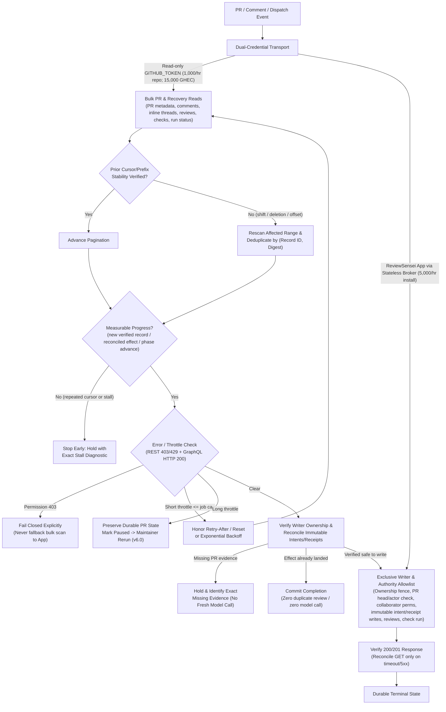

# ReviewSensei v6 Proposal: GitHub-Governed Full Recovery

> [!IMPORTANT]
> **Status:** Revised v6 design proposal (accompanied by [ADR 0144](../adr/0144-github-governed-recovery.md)).  
> **Guarantee:** **Recover when the required evidence is available; otherwise identify the blocker and hold.** Recovery never starts a fresh model call as a fallback.  
> **Rollout posture:** Keep **`v5` pinned** on `caller-requests-v2` until every v6 release gate below passes.  
> **Out of scope:** Model/provider token budgets, maintainer override authorization policy, and existing write-safety checks remain unchanged.

---

## 1. Executive Decision

ReviewSensei v6 replaces fixed recovery request and page-count ceilings (`limit=512`, `first_work=141`, fixed `MAX_PAGINATION_PAGES` recovery caps) with **GitHub-governed, progress-guarded recovery** built on five non-negotiable invariants:

1. **The pull request is the only durable recovery ledger.** Zero external databases (preserving the stateless Cloudflare broker established in [deploy/cloudflare/wrangler.jsonc](../../deploy/cloudflare/wrangler.jsonc) migration `v3`) and zero `contents: write` expansion. Unresolved results stay on the PR; optional Actions Artifacts may cache a copy, never replace PR truth.
2. **Split credentials with an explicit narrow App-read allowlist.** Bulk PR/repository scans run on the workflow's read-only `GITHUB_TOKEN`; mutations and narrow independent authority-verification reads stay behind the stateless ReviewSensei App write broker (codified in [v6_credential_matrix.py](../../packages/python/review-sensei-github/src/review_sensei_github/v6_credential_matrix.py)).
3. **Exclusive writer ownership + immutable intent and receipt records.** Updating a single PR comment (`PATCH`) does **not** provide compare-and-swap (CAS). Every write boundary proves exclusive writer ownership, and intent/receipt records are immutable so a stale runner cannot erase an outstanding write or completed receipt.
4. **Stability-verified pagination with rescan-and-deduplicate fallback.** Resume only from a position whose stability (including earlier pages) can be verified; otherwise rescan the affected range and deduplicate by stable record ID and content digest.
5. **GitHub-governed throttling + persistent no-progress loop guard.** Respect GitHub's actual REST and GraphQL rate-limit signals (including HTTP `200` GraphQL `RATE_LIMITED` responses), separate rate limits strictly from permission errors (`403`), pause cleanly for a maintainer rerun in v6.0 when waits are long, and stop early on lack of measurable progress even with quota left.

---

## 2. Why v5 Hits Artificial Cliffs

In `v5` (`caller-requests-v2`), `owner_allocations()` slices `DEFAULT_API_REQUEST_LIMIT = 512` down to ~27% usable work (`startup=130`, `successor=191`, `terminal=50`, leaving `first_work=141`). On a real multi-round PR (gen 21), `spent_before_preflight=66` + `3` lifecycle checkpoints (`36`) + `native_tail_calls=40` = `142 > 141` aborted by **1 call** while **371 calls** went unused and GitHub itself had thousands of requests available.

Raising `512` to another static cap only shifts the cliff (compare the earlier fixed-cap analysis in [pr271-request-reduction.md](pr271-request-reduction.md)). v6 removes fixed recovery **read** ceilings altogether while strengthening writer exclusivity, pagination soundness, and evidence preservation.

---

## 3. Architecture Overview

---

## 4. Core Design Pillars

### Pillar 1: Split Credentials & Explicit Broker App-Read Allowlist

#### A. Bulk Reads on Read-Only `GITHUB_TOKEN`
| Surface / Operation | Credential | Required Permission | Notes |
| --- | --- | --- | --- |
| PR metadata, commits, diff, PR files (GitHub caps PR files at 3,000) | `GITHUB_TOKEN` | `pull-requests: read`, `contents: read` | Already granted in [.github/workflows/review-sensei-run.yml](../../.github/workflows/review-sensei-run.yml). |
| PR conversation comments (100/page) & inline review comments | `GITHUB_TOKEN` | `issues: read`, `pull-requests: read` | Moves highest-volume pagination off the App quota. |
| PR reviews & GraphQL `reviewThreads` (including `originalCommit { oid }`) | `GITHUB_TOKEN` | `pull-requests: read` | Batches thread/root inspection cleanly. |
| Check runs & check suites | `GITHUB_TOKEN` | **`checks: read`** *(new read-only scope)* | Requires updating [review-sensei-run.yml](../../.github/workflows/review-sensei-run.yml), [tests/test_ci_policy.py](../../tests/test_ci_policy.py), and `REGISTRY_ONLY_WORKFLOWS`. |
| Workflow run / job status (predecessor & liveness reads) | `GITHUB_TOKEN` | **`actions: read`** *(new read-only scope)* | Strictly read-only; verifies active/predecessor runs off App quota. |

#### B. Explicit App-Read Allowlist (Broker Independent Authority Verification)
The stateless broker still requires a **strictly enumerated, narrow set of `O(1)` App reads** to independently verify write authority before any mutation:

| Broker App Read | Why It Cannot Move to `GITHUB_TOKEN` | Bound |
| --- | --- | --- |
| **1. App / Bot Identity (`GET /app` or cached installation app metadata)** | Establishes authoritative App bot ID / `performed_via_github_app` identity independent of caller claims. | Cached / `O(1)` |
| **2. Live PR Binding & Head/Base/State Fence (`GET /repos/{o}/{r}/pulls/{n}`)** | Independently verifies repository ID, PR number, `state`, `head.sha`, and `base.sha` immediately before minting/applying a write (prevents stale caller reads or cross-token replication lag). | `O(1)` per write boundary |
| **3. Collaborator Permission Check (`GET /repos/{o}/{r}/collaborators/{user}/permission`)** | Required for maintainer commands (`@reviewsensei override`, `accept-coverage-uncertainty`). Read-only `GITHUB_TOKEN` (especially on fork PRs) returns `403` on collaborator permission lookups. | `O(1)` per maintainer command |
| **4. Active-Writer / Run-Liveness Fence (`GET /repos/{o}/{r}/actions/runs/{run_id}` + exact target ownership check)** | Independently verifies the requesting OIDC workflow run is still the sole active writer at the write boundary before applying a mutation. | `O(1)` per write boundary |
| **5. Targeted Effect Verification on Ambiguous/Lost Write (by exact review/comment/check-run ID or bounded target lookup)** | Independently confirms whether a broker-dispatched mutation landed when the HTTP response was lost, without trusting unverified caller state. | Narrow, bounded to the disputed effect |

> [!CAUTION]
> **Hard invariant:** Never fall back to the App installation token for ordinary PR scans or pagination when a `GITHUB_TOKEN` read fails. Report any denied read (`403` permission error) explicitly and fail closed.

---

### Pillar 2: Exclusive Writer Ownership & Immutable Intent / Receipt Records

> [!WARNING]
> **No pseudo-CAS via single-comment `PATCH`.** GitHub comment `PATCH` provides no compare-and-swap precondition. If two writers ever overlap (e.g., delayed retry, manual dispatch racing a PR event, or stale runner resuming after timeout), an in-place `PATCH` on a shared comment can silently overwrite an outstanding `pending_write_intent` or completed receipt.

v6 prevents overlapping writers from losing evidence using **two layered guarantees**:

1. **Exclusive Writer Ownership Proved at Every Write Boundary:**
   - Workflow concurrency (`cancel-in-progress: false` per `(repo, pr)`) provides first-line serialization, **not** the sole safety guarantee.
   - At every write boundary, the broker independently proves exclusive writer ownership against the live PR state and run identity (binding `repository_id`, `pull_request`, `operation_id`, `run_id`, `run_attempt`, `writer_epoch`, and live `head_sha`), refusing any write from a superseded or non-owning runner.
2. **Immutable Intent and Receipt Records (Never Destructively Overwritten):**
   - **Write Intent Record (immutable):** Before dispatching a non-idempotent external mutation (review publication, approval, terminal check update), record an **immutable** App-authored intent entry carrying `(operation_id, writer_epoch, pr_head_sha, effect_kind, payload_sha256, target_digest)`.
   - **Completion Receipt Record (immutable):** Once confirmed (either from the `200`/`201` write response verified byte-for-byte, or via reconciliation after a lost response), record an **immutable** App-authored completion receipt carrying `(operation_id, github_effect_id, payload_sha256, completed_at)`.
   - **Stale-writer immunity:** Even if a stale runner somehow attempts a write, it cannot overwrite or erase another writer's immutable intent or receipt record. Reconciliation always observes the union of immutable intents and receipts by `(record_id, operation_id, payload_sha256)`.
   - **Advisory progress/hint state:** Any compact progress/stall checkpoint updated during long read scans is strictly scoped to **read-phase progress hints** (`stall_count`, `last_progress_digest`, `verified_boundary_hint`) and **never** holds the sole copy of an unresolved write intent, receipt, or review result.

---

### Pillar 3: Stability-Verified Pagination & Persistent No-Progress Guard

#### 1. Stability-Verified Resumption (Deletion-Safe)
- **Why matching a single boundary anchor is insufficient:** If a comment *earlier* than the saved anchor is deleted between runs, offset-based REST pages (`page=N`) shift left—even if the anchor comment itself still exists, earlier-page boundaries moved and previously scanned items or App records could have changed or been removed.
- **v6 Pagination Contract:**
  1. Scan in deterministic ascending order (GraphQL forward node-ID cursors `first: 100, after: $cursor`, or REST `sort=created&direction=asc`; never `since=`, which reorders on comment edits).
  2. **Resume only when prefix/position stability is provable** — e.g.:
     - GraphQL `totalCount` + prefix digest / verified anchor chain proves no earlier items were deleted/inserted before the cursor, **and** the cursor node ID still resolves identically; **or**
     - The surface is strictly append-only and verified unchanged up to the boundary.
  3. **Whenever stability cannot be proven** (e.g., any REST offset pagination, `totalCount` decreased/changed, anchor missing, or head/generation shifted): **rescan the affected range** and **deduplicate deterministically by `(stable_record_id, content_sha256)`**.
  4. Because bulk scans use `GITHUB_TOKEN` with no artificial 75-call cap, rescanning and deduplicating guarantees **zero silently skipped records** even under arbitrary comment deletions.

#### 2. Measurable Progress & Cross-Restart Loop Guard
- **Counts as progress (resets `stall_count = 0`):**
  1. Verifying at least one new distinct `(stable_record_id, content_sha256)` record,
  2. Reconciling an immutable intent to a confirmed receipt, or
  3. Advancing to a strictly later recovery phase.
- **Does NOT count as progress (increments `stall_count`):**
  - Repeating an unchanged cursor/page or receiving zero newly verified records (even under a different opaque cursor string),
  - Re-entering the same phase with an unchanged `last_progress_digest`.
- Persist `stall_count`, `last_progress_digest`, and `transient_error_count` on the PR so restarts never reset the loop guard. Exceeding `max_stall_steps` or `max_transient_retries` halts early with an explicit stall diagnostic even when GitHub quota remains.

---

### Pillar 4: PR-Resident Unresolved Results & Artifact Caching Policy

> [!CAUTION]
> **Unresolved results live on the PR. Recovery NEVER starts a fresh model call as a fallback.**

- **PR is the sole durable ledger for unresolved results:**
  - Every unresolved finding inventory, pending obligation, visible prose overflow (via verified companion `COMMENT` reviews from PR #507), and immutable intent/receipt record is persisted on the PR.
- **Actions Artifacts are strictly optional cache copies:**
  - A workflow artifact (pinned by SHA-256) may cache a copy for faster hydration, **never** as the sole store of unresolved results.
  - **If the artifact is missing or expired:** Recover completely from the PR.
  - **If the PR itself is missing required evidence** (e.g., an admin manually deleted required App comments/reviews): **Hold and identify the exact missing evidence** (record/digest/surface). Do **not** silently fall back to a fresh model call during recovery.
- **Request compression (preserving zero extra permissions):**
  - Treat GitHub's `200`/`201` write response as its own verified readback (`GET` reconcile only on timeout/`5xx`), cutting normal write calls in half.
  - Batch reads with GraphQL where supported (`headRefOid`, `baseRefOid`, `state`, reviews, `reviewThreads` with `originalCommit { oid }`).
  - Keep a separate per-operation **mutation sanity bound** independent of the removed read ceiling so a bug cannot spam comments.
  - Always print the complete diagnostic breakdown (`reads`, `capability_mints`, `review_update`, `cleanup_threads`, `other_writes`, `restore_and_snapshot_reads`, `body_receipt_calls`, `check_run`, `approval`, `receipt_calls`).

---

### Pillar 5: GitHub-Governed Throttling & Rate-Limit vs. Permission Separation

- **Independent quota tracking:** Track `GITHUB_TOKEN` (1,000 REST req/hr/repo; 15,000 GHEC) and the ReviewSensei App installation token (5,000/hr across installation) independently.
- **Strict classification — rate limits vs. permission errors:**
  - **REST primary rate limit:** HTTP `403` or `429` with `X-RateLimit-Remaining: 0` (or `X-RateLimit-Reset`).
  - **REST secondary (abuse) rate limit:** HTTP `403` or `429` with `Retry-After` or GitHub secondary rate-limit error body.
  - **GraphQL rate limit inside HTTP `200`:** HTTP `200` JSON body containing `errors[].type == "RATE_LIMITED"` (or `data.rateLimit.remaining == 0` / rate-limit message) — **must** be classified as throttling, never as a malformed response or silent empty result.
  - **Permission error:** HTTP `403` without primary/secondary rate-limit indicators (e.g., missing scope or fork PR restriction) — **must** fail closed as a permission/credential error, never retried with backoff and never silently routed to the App token.
- **Pause & resume policy for v6.0:**
  - **Short waits** (within configured in-job sleep cap, e.g. `<= 5 min` with job timeout headroom): honor `Retry-After` / reset timestamp (or bounded exponential backoff with jitter when neither is present) and continue in-job.
  - **Long waits (v6.0):** Persist durable PR progress state (reusing the prior durable state if saving itself is throttled), publish a clear `paused-rate-limited` check status with the exact `resume_after` timestamp, and exit cleanly for a **maintainer rerun** (`@reviewsensei verify` / Actions rerun). **Automatic scheduling / delayed dispatch is explicitly deferred beyond v6.0** to keep the broker 100% stateless.

---

### Pillar 6: Reconcile-Before-Retry Write Safety

1. Record an **immutable write intent** (`operation_id`, `writer_epoch`, `pr_head_sha`, `effect_kind`, `payload_sha256`) and verify exclusive writer ownership before dispatching any external write.
2. If a write response is lost (timeout, `5xx`, runner killed mid-write):
   - On recovery, scan the target GitHub surface (with stability-verified pagination / rescan + deduplication) and perform targeted broker verification for the matching `operation_id` / `payload_sha256`.
   - **Effect landed:** Record the immutable completion receipt and advance — **zero duplicate reviews, zero extra model calls**.
   - **Effect provably absent** (complete verified scan shows no matching marker and PR holds the saved result): Resume publication from the saved PR result — **zero extra model calls**.
   - **Outcome ambiguous or required PR evidence missing:** **Hold and identify the exact missing evidence / blocker.**

---

## 5. Complete PR Recovery Matrix

| Scenario | Detection | v6 Behavior | Guarantee |
| --- | --- | --- | --- |
| **Deep PR history (>75 / >512 calls)** | Normal `GITHUB_TOKEN` pagination | Continues without fixed read cap; respects GitHub rate-limit headers | Zero App scan quota burn |
| **Comment deleted before saved anchor** | Stability check fails (offset / `totalCount` / prefix mismatch) | Rescans affected range and deduplicates by `(stable_record_id, digest)` | Zero silently skipped records |
| **Pagination loop / repeated cursor** | `progress_guard` detects no newly verified records / unchanged digest | Halts early with exact stall diagnostic even with quota remaining | Loop guard survives restarts |
| **Overlapping / stale runner** | Broker exclusive-writer ownership check + immutable intents/receipts | Rejects stale writer at write boundary; immutable intents/receipts intact | Zero lost intents or receipts |
| **REST `403`/`429` or GraphQL HTTP `200` `RATE_LIMITED`** (either credential) | Separate throttle classifier (distinct from `403` permission errors) | Short wait: backoff/sleep in-job. Long wait: preserve durable PR state, exit cleanly for maintainer rerun (v6.0) | Clean resume from PR alone |
| **Permission `403` (fork / private / missing scope)** | Permission classifier (no rate-limit header/body) | Fails closed explicitly with endpoint + credential diagnostic | Never silently falls back bulk scans to App token |
| **Lost write response after GitHub accepts write** | Unreconciled immutable intent on resume | Reconciles target surface by `operation_id` + `payload_sha256`, records receipt | **Zero duplicate reviews; zero extra model calls** |
| **Optional Actions Artifact expired / deleted** | Artifact missing on restart | Recovers completely from PR-resident unresolved results | Zero fallback model calls |
| **Required PR evidence missing / deleted** | Integrity / completeness check | **Holds and identifies exact missing evidence** | Never guesses or runs a fresh model call |
| **PR head/base/policy moved or PR closed** | Pre-write broker fence | Benign lifecycle race classification or clean re-anchor | Zero stale-head publications |
| **Oversized prose / mirrors / drift roots** | Existing PRs #505, #507, #508 contracts | Companion prose reviews, 3-snapshot mirror proof, `originalCommit` + unique Tier 4 matching | Preserved end-to-end |

---

## 6. Phased Implementation & Release Gate

Keep **`v5` pinned** throughout. Ship and verify in strict order:

1. **Phase 0 — Credential & Permission Matrix Tests:**
   - Document and test every endpoint across **same-repo**, **private repo**, and **fork PRs** (`pull_request`, `issue_comment`, `workflow_dispatch`) in [v6_credential_matrix.py](../../packages/python/review-sensei-github/src/review_sensei_github/v6_credential_matrix.py) and [tests/test_v6_credential_matrix.py](../../tests/test_v6_credential_matrix.py).
   - Add `checks: read` and `actions: read` to the v6 reusable workflow; update [tests/test_ci_policy.py](../../tests/test_ci_policy.py) and workflow SHA-256 allowlists.
   - Assert bulk scans exclusively use `GITHUB_TOKEN` and broker reads strictly match the Pillar 1B allowlist.
2. **Phase 1 — Dual-Credential Transport & Separate Rate-Limit / Permission Classifiers:**
   - Independent quota tracking for `GITHUB_TOKEN` and App token.
   - Dedicated tests separating **permission `403`** from **REST `403`/`429` rate limits** AND **GraphQL HTTP `200` `RATE_LIMITED` responses**.
3. **Phase 2 — Exclusive Writer Fencing, Immutable Intents/Receipts, Stability-Verified Pagination & No-Progress Guard:**
   - Implement broker writer-ownership fencing + immutable intent/receipt records.
   - Implement stability verification + rescan-and-deduplicate fallback + cross-restart `progress_guard`.
   - Remove fixed recovery read/page ceilings while retaining per-operation mutation sanity bounds and complete diagnostic breakdowns.
4. **Phase 3 — Request Compression & Reconcile-Before-Retry:**
   - Write-response-as-readback (`GET` only on timeout/`5xx`), GraphQL read batching, and exact lost-write reconciliation reusing saved PR results.
5. **Phase 4 — v6 Release Gate (Mandatory Before Unpinning `v5`):**
   - [ ] **Past 75-request boundary:** Cold recovery needing >75 requests (and >512 simulated requests) completes with no cap increase.
   - [ ] **Comment deletion mid-recovery:** Deleting a comment before a saved anchor triggers safe rescan + `(record_id, digest)` deduplication with zero missed items.
   - [ ] **Pagination loop guard:** Repeated cursor / unchanged page (including under a new cursor string and across a restart) halts early with quota left.
   - [ ] **Throttling on both credentials:** REST `403`/`429` AND GraphQL HTTP `200` `RATE_LIMITED` pause cleanly and resume via maintainer rerun; permission `403` fails closed separately without retry or App fallback.
   - [ ] **Overlapping/stale writer:** Stale runner is rejected at the write boundary and cannot overwrite or erase an active writer's immutable intent or receipt.
   - [ ] **Lost write response:** GitHub accepts a write whose response is dropped; recovery reconciles cleanly with **zero duplicate reviews** and **zero extra model calls**.
   - [ ] **Missing PR evidence hold:** Deleting required PR evidence causes recovery to **hold and identify the exact missing evidence** with **zero fallback model calls**.
   - [ ] **Artifact-free restart:** Every restart test runs with **all optional artifacts and caches deleted**, proving the PR alone holds durable recovery state.
   - [ ] **Exact qualification:** Qualify the exact v6 caller workflow and runner package before rollout; keep `v5` pinned until all gates are green.
