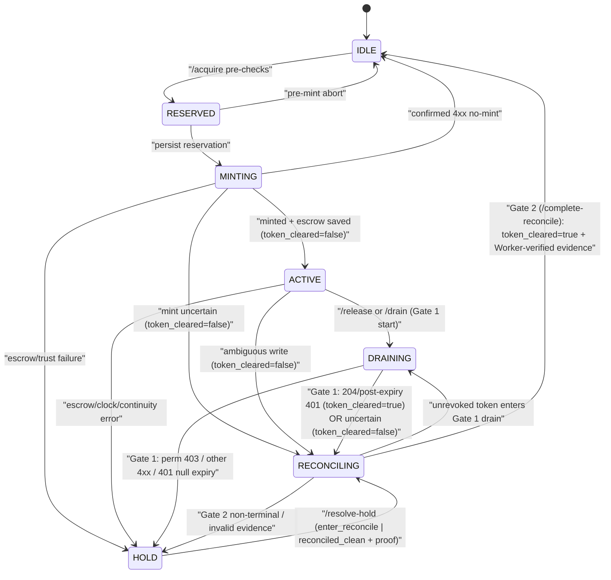

# ReviewSensei v6 Phase 0 Issuance Audit & Phase 1 Shared Contract Freeze

> [!IMPORTANT]
> **Status:** Frozen Phase 0 Audit & Phase 1 Two-Gate Contract (accompanied by [ADR 0145](../adr/0145-v6-one-writer-per-pr-coordinator.md) and [v6-coordinator-contract.json](../../src/review_sensei/schemas/v6-coordinator-contract.json)).
> **Pinned Baseline:** `main` at `ff406a44754d5016fead2435e547b9fd0536e17b`; `PUBLIC_WORKFLOW_TAG: "v5"` pinned at `40b4f52face3402fc3a9cd51387bde7cf53c3951` (`40b4f52f`, `review-sensei==0.8.28`, `review-sensei-github==0.3.34`).
> **Constraints:** Zero new GitHub App permissions, zero new Wrangler secrets, zero Worker PR write proxying, and zero changes to `v5`.

---

## 1. Phase 0 — Pinned Baseline & GitHub App Issuance Audit

### 1.1 Pinned Production Baseline

| Artifact | Pinned Identity | Source of Truth |
| --- | --- | --- |
| Default branch (`main`) | `ff406a44754d5016fead2435e547b9fd0536e17b` | `origin/main` |
| Public workflow channel (`v5`) | `40b4f52face3402fc3a9cd51387bde7cf53c3951` (`40b4f52f`) | `refs/tags/v5`, [deploy/cloudflare/wrangler.jsonc](../../deploy/cloudflare/wrangler.jsonc) |
| Core engine package | `review-sensei==0.8.28` (`v0.8.28`) | [pyproject.toml](../../pyproject.toml) |
| Hosted GitHub package | `review-sensei-github==0.3.34` (`github-v0.3.34`) | [packages/python/review-sensei-github/pyproject.toml](../../packages/python/review-sensei-github/pyproject.toml) |

### 1.2 Exhaustive Audit of Every GitHub App Write-Access Path

Every code path in this repository capable of minting or using GitHub App installation tokens is accounted for below:

| # | Issuance / Write Path | Exact File Paths & Symbols | Requested / Granted Permissions | Scope & Operational Owner |
| --- | --- | --- | --- | --- |
| 1 | **v5 OIDC Capability Broker** (`POST /github/token`) | [worker.ts](../../deploy/cloudflare/src/worker.ts) (`token`) → [token-broker.ts](../../deploy/cloudflare/src/token-broker.ts) (`TokenBroker.exchange`, `CAPABILITIES`) → [github-api.ts](../../deploy/cloudflare/src/github-api.ts) (`GitHubApi.capabilityTokenObservation`, `GitHubApi.capabilityToken`) | 9 capabilities across [.github/workflows/review-sensei-run.yml](../../.github/workflows/review-sensei-run.yml)@`v5` (called by [.github/workflows/review-sensei-review.yml](../../.github/workflows/review-sensei-review.yml) and disabled [.github/workflows/review-sensei-quarantine.yml](../../.github/workflows/review-sensei-quarantine.yml)): `review_publish` (`contents: read, pull_requests: write`), `thread_resolve` (`contents: write, pull_requests: write`), `check_publish` (`checks: write`), `review_session` (`contents: read, pull_requests: write`), `review_status` (`contents: read, pull_requests: read`), `review_actions` (`actions: read`), `inline_reply` (`contents: read, pull_requests: write`), `issue_reply` (`contents: read, pull_requests: write`), `learning_write` (`contents: write, pull_requests: write`) | Existing `v5` production channel. Rejected for opt-in pilot repos listed in `V6_PILOT_REPOSITORIES` via `broker_v6_pilot_v5_writer_disabled`. |
| 2 | **App Installation Setup Bootstrap** (`POST /github/webhook`, `POST /github/setup-continue`) | [worker.ts](../../deploy/cloudflare/src/worker.ts) (`webhook`, `setupContinue`) → [setup-step.ts](../../deploy/cloudflare/src/setup-step.ts) (`runSignedSetupStep`) → [github-app.ts](../../deploy/cloudflare/src/github-app.ts) (`GitHubSetupService.process`, `REQUIRED_SETUP_PERMISSIONS`) → [github-api.ts](../../deploy/cloudflare/src/github-api.ts) (`GitHubApi.installationToken`) | `contents: write`, `pull_requests: write`, `workflows: write` | Strictly scoped to creating/updating setup branch `review-sensei/setup-v5*` and its setup PR on installation lifecycle events. Never writes to PR review streams. |
| 3 | **Direct Python App JWT Path** | [auth.py](../../packages/python/review-sensei-github/src/review_sensei_github/auth.py) (`GitHubAppAuth.create_app_jwt`, `GitHubAppAuth.installation_token`, `GitHubTokenTransport.request_installation_token`) and [broker.py](../../packages/python/review-sensei-github/src/review_sensei_github/broker.py) (`OIDCBroker.exchange`) | Caller-supplied `RequestedPermissions` | **Explicitly excluded from hosted pilot repositories.** Hosted runners and pilot repositories never receive `GITHUB_APP_PRIVATE_KEY`. |
| 4 | **Planned v6 Per-PR Coordinator** (`POST /github/v6/lease/*`) | Frozen in [v6-coordinator-contract.json](../../src/review_sensei/schemas/v6-coordinator-contract.json); Worker DO `V6PrCoordinator` (`deploy/cloudflare/`, Phase 2 implementation) | Per-lease capability set from the v6 writer surface (`pull_requests: write`, `checks: write`, `contents: write` only when `learning_write` / `thread_resolve` requires it) | Sole authorized write-token issuer for opt-in v6 pilot repositories. |
| 5 | **Ad Hoc Reruns, `workflow_dispatch`, Break-Glass Keys, Duplicate Brokers** | Actions UI reruns, manual `workflow_dispatch` on non-pinned refs, secondary Cloudflare deployments, or personal/App break-glass tokens | Any repo write / App token | **Explicitly excluded from pilot scope.** Pre-admission requires completing a **1-hour (3600s) token drain** after adding the repository to `V6_PILOT_REPOSITORIES` (or confirming zero active v5 tokens remain unrevoked) before admitting v6 coordinator traffic. |

### 1.3 Complete Inventory of Native Writer Actions & Minimum Repository Permissions

Every external write emitted by the ReviewSensei GitHub writer (`packages/python/review-sensei-github/src/review_sensei_github/`) and its minimum repository permissions are listed below:

| Native Writer Action | GitHub API Endpoint(s) | Writer Module(s) | v5 Broker Capability | Minimum Repository Permissions |
| --- | --- | --- | --- | --- |
| **PR review submission** (ordinary `COMMENT`, companion overflow prose `COMMENT`, eligible `APPROVE`) | `POST /repos/{owner}/{repo}/pulls/{pull_number}/reviews`, `PUT /repos/{owner}/{repo}/pulls/{pull_number}/reviews/{review_id}` | [application.py](../../packages/python/review-sensei-github/src/review_sensei_github/application.py), [publication.py](../../packages/python/review-sensei-github/src/review_sensei_github/publication.py), [approval.py](../../packages/python/review-sensei-github/src/review_sensei_github/approval.py) | `review_publish` | `pull_requests: write` (v5 also requests `contents: read`) |
| **Issue comment / PR ledger entry** (session records, `owner`/`intent`/`receipt`/`non-submission`/`hold`/`unresolved`/`progress` markers, command/issue replies) | `POST /repos/{owner}/{repo}/issues/{pull_number}/comments`, `PATCH /repos/{owner}/{repo}/issues/comments/{comment_id}` | [application.py](../../packages/python/review-sensei-github/src/review_sensei_github/application.py), [action_receipt.py](../../packages/python/review-sensei-github/src/review_sensei_github/action_receipt.py), [v6_recovery_ledger.py](../../packages/python/review-sensei-github/src/review_sensei_github/v6_recovery_ledger.py) | `review_session`, `issue_reply`, `review_publish` | `pull_requests: write` (or `issues: write` + `pull_requests: write` per [v6_credential_matrix.py](../../packages/python/review-sensei-github/src/review_sensei_github/v6_credential_matrix.py)) |
| **Inline review comment / reply** | `POST /repos/{owner}/{repo}/pulls/{pull_number}/comments/{comment_id}/replies`, `POST /repos/{owner}/{repo}/pulls/{pull_number}/comments` | [conversation.py](../../packages/python/review-sensei-github/src/review_sensei_github/conversation.py), [publication.py](../../packages/python/review-sensei-github/src/review_sensei_github/publication.py) | `inline_reply` | `pull_requests: write` |
| **GraphQL thread resolution / unresolution / thread reply** | `POST /graphql` (`resolveReviewThread`, `unresolveReviewThread`, `addPullRequestReviewThreadReply`) | [thread_resolution.py](../../packages/python/review-sensei-github/src/review_sensei_github/thread_resolution.py), [finding_lifecycle.py](../../packages/python/review-sensei-github/src/review_sensei_github/finding_lifecycle.py) | `thread_resolve` | `pull_requests: write` (v5 requests `contents: write, pull_requests: write`) |
| **Check run publish / update** (`ReviewSensei` merge gate & `paused-rate-limited`) | `POST /repos/{owner}/{repo}/check-runs`, `PATCH /repos/{owner}/{repo}/check-runs/{check_run_id}` | [application.py](../../packages/python/review-sensei-github/src/review_sensei_github/application.py), [trust_disposition.py](../../packages/python/review-sensei-github/src/review_sensei_github/trust_disposition.py), [finding_lifecycle.py](../../packages/python/review-sensei-github/src/review_sensei_github/finding_lifecycle.py) | `check_publish` | `checks: write` |
| **Learning PR branch, file, and PR write** | `POST /repos/{owner}/{repo}/git/refs`, `PATCH /repos/{owner}/{repo}/git/refs/heads/{branch}`, `PUT /repos/{owner}/{repo}/contents/{path}`, `POST /repos/{owner}/{repo}/pulls` | [learning_pr.py](../../packages/python/review-sensei-github/src/review_sensei_github/learning_pr.py), [application.py](../../packages/python/review-sensei-github/src/review_sensei_github/application.py) | `learning_write` | `contents: write`, `pull_requests: write` |

*(Read-only broker capabilities `review_status` (`contents: read, pull_requests: read`) and `review_actions` (`actions: read`) emit zero mutations.)*

### 1.4 Pilot Isolation, Rollback Invariant & GitHub Installation-Token Boundary

1. **Channel isolation:** `PUBLIC_WORKFLOW_TAG` stays pinned to `v5` (`40b4f52f`). Non-pilot repositories continue executing `review-sensei-run.yml@v5` against `POST /github/token` unchanged.
2. **Hard v5 writer block for pilots:** Any repository present in `V6_PILOT_REPOSITORIES` is rejected by v5 `TokenBroker.exchange` with sanitized diagnostic `broker_v6_pilot_v5_writer_disabled` so a v5 runner and a v6 runner can never hold active write tokens for the same PR simultaneously.
3. **Pre-admission 1-hour drain:** Because GitHub installation tokens have up to a 60-minute lifetime, a repository newly added to `V6_PILOT_REPOSITORIES` must complete a 1-hour (`3600` seconds) drain window (with zero v5 writer tokens issued) before any v6 coordinator lease is admitted.
4. **Ordered `v6 -> v5` rollback invariant:** To roll back a pilot repository cleanly without v5/v6 token overlap:
   1. Add the repository to `V6_PILOT_ROLLBACK_REPOSITORIES` first to block all new v6 lease acquisitions (`IDLE -> RESERVED`) immediately.
   2. Drain and reconcile every active, draining, or reconciling slot for that repository until all slots are `IDLE` with zero unresolved `HOLD` obligations.
   3. Only once every slot is `IDLE` and free of `HOLD` obligations, remove the repository from `V6_PILOT_REPOSITORIES` and `V6_PILOT_ROLLBACK_REPOSITORIES`, re-enabling `v5` `TokenBroker.exchange`.
5. **GitHub token scoping caveat:** GitHub scopes installation access tokens to `(repository, permissions)` — **not** to a single pull request number. Therefore, the `v6-pr:...` slot key is a **ReviewSensei coordination boundary** (not a GitHub-enforced per-PR token restriction) that relies on:
   - trusted, tag/SHA-pinned v6 reusable workflow and package code,
   - zero independent write credentials (no App private key or PAT on runners), and
   - strict fork-PR isolation (fork PRs never execute PR-controlled code, actions, or config in any job holding OIDC or write capabilities).

### 1.5 Independent Worker Proof Sources

The Worker verifies every lease operation independently without adding GitHub App permissions, without bulk PR pagination, and without proxying PR writes:

| Proof Surface | Exact Verification Mechanism / Endpoint | Verified Facts |
| --- | --- | --- |
| **Actions OIDC JWT** | [oidc.ts](../../deploy/cloudflare/src/oidc.ts) (`verifyOidcAssertion`) via RS256 JWKS | `iss`, `aud` (`sts.reviewsensei.dev`), `exp`/`nbf`/`iat`, `repository`, `repository_owner`, `repository_id`, `job_workflow_ref`, `job_workflow_sha`, `run_id`, `run_attempt`, `event_name`, `runner_environment` |
| **App & Installation Identity** | `GET /app` and `GET /repos/{owner}/{repo}/installation` (App JWT) | Authoritative `app_id`, bot login (`{slug}[bot]`), `installation_id` |
| **Immutable Base Repo & Live PR Head** | `GET /repos/{owner}/{repo}` (`id`, `fork`) and `GET /repos/{owner}/{repo}/pulls/{pr}` (`head.sha`, `base.repo.id`, `state`) via internal read-only token (never disclosed to caller) | Confirms non-fork base repository identity (`base_repo_id`), live `head.sha`, and `state` |
| **Run / Attempt & Predecessor Terminal Cessation** | `GET /repos/{owner}/{repo}/actions/runs/{run_id}` and `GET /repos/{owner}/{repo}/actions/runs/{run_id}/attempts/{attempt}` using existing `actions: read` App permission | Proves predecessor attempt reached terminal cessation (`status === "completed"` and non-null terminal `conclusion`) before successor takeover |
| **Targeted O(1) PR Ledger & Gate 2 Reconciliation Evidence** | `GET /repos/{owner}/{repo}/issues/comments/{comment_id}` (`GitHubApi.issueComment`), bounded `GET /repos/{owner}/{repo}/issues/{pr}/comments?per_page=100&since={slot_acquired_at}` (fail closed on truncation/`Link: rel="next"`), and O(1) native effect readback (`reviews/{id}`, `issues/comments/{id}`, `pulls/comments/{id}`, `check-runs/{id}`) | Verifies App bot authorship, canonical SHA-256 marker digest, protocol version, repo/PR binding, `coordinator_attestation_mac`, 100% intent coverage for `old_generation`, and each Gate 2 resolution proof (zero Worker PR writes) |

### 1.6 Phase 0 Independent Blockers (All `OPEN` at Phase 0)

| Blocker ID | Blocker | Phase 0 Status | Required Closure |
| --- | --- | --- | --- |
| `callable_v6_workflow` | Callable v6 workflow | `OPEN` | Published pinned v6 workflow preserving fork/policy isolation and `actions: read`/`checks: read` read-only token split |
| `fenced_issuance` | Fenced issuance | `OPEN` | `V6PrCoordinator` Durable Object + `/github/v6/lease/*` routes + two-gate escrow/revocation/reconciliation tests |
| `reproducible_ambiguous_write_recovery` | Reproducible ambiguous-write recovery | `OPEN` | Deterministic reconcile-before-retry and artifact-free recovery on lost/timeout writes |
| `opt_in_github_qualification` | Opt-in GitHub qualification | `OPEN` | End-to-end live pilot verification against all Phase 4 gates before expanding beyond pilot |

---

## 2. Phase 1 — Two-Records Separation & Frozen Two-Gate Wire Protocol

### 2.1 Canonical Slot Key

Every PR coordination slot is identified by:

```text
v6-pr:{host}:{app_id}:{installation_id}:{base_repo_id}:{pr_number}
```

- **Host canonicalization:** `host` MUST be normalized to a lowercase ASCII hostname with no port, path, or whitespace before constructing `slot_key` (e.g., `github.com`, `api.github.example.com`).
- **Regex:** `^v6-pr:[a-z0-9.-]+:[1-9][0-9]*:[1-9][0-9]*:[1-9][0-9]*:[1-9][0-9]*$`
- **Example:** `v6-pr:github.com:12345:67890:987654321:42`

### 2.2 Two-Records Separation: Keep vs. Never-Keep

#### A. PR Ledger (`reviewsensei:v6:record`) — Sole Durable Recovery Ledger

All durable PR recovery state lives in App-authored PR HTML comment markers:

```text
<!-- reviewsensei:v6:record sha256={sha256_hex} payload={canonical_json} -->
```

- **Marker safety & size ceiling:** Encoded markers MUST be `<= 65536` UTF-8 bytes (`max_encoded_bytes: 65536`). `canonical_json` MUST escape `<` as `\u003c` and `>` as `\u003e` so literal `-->` and `<!--` can never appear inside `payload`; trailing ` -->` is the sole allowed terminator, and parsers MUST reject any embedded `-->` or `<!--`. SHA-256 is computed over the canonical JSON of the decoded record.

| Record Type | Schema ID | Purpose & Required Fields |
| --- | --- | --- |
| **Owner Anchor** | `reviewsensei:v6:owner:v1` | Coordinator-attested ownership anchor (`schema`, `record_id`, `slot_key`, `generation`, `lease_epoch`, `reservation_id`, `operation_id`, `run_id`, `run_attempt`, `pr_head_sha`, `workflow_sha`, `acquired_at`, `expires_at`, `coordinator_attestation_mac`). |
| **Write Intent** | `reviewsensei:v6:intent:v1` | Immutable pre-mutation intent (`schema`, `record_id`, `operation_id`, `writer_epoch`, `pr_head_sha`, `effect_kind`, `payload_sha256`, `target_digest`; optional for legacy / required for v6 pilot: `generation`, `target_location`). |
| **Completion Receipt** | `reviewsensei:v6:receipt:v1` | Immutable post-confirmation/reconciliation receipt (`schema`, `record_id`, `operation_id`, `writer_epoch`, `github_effect_id`, `payload_sha256`, `completed_at`). |
| **Non-Submission Proof** | `reviewsensei:v6:non-submission:v1` | Affirmative App-authored non-submission proof (`schema`, `record_id`, `slot_key`, `generation`, `operation_id`, `pr_head_sha`, `proof_kind` [`definitive_github_rejection` \| `pre_dispatch_terminal_abort`], `payload_sha256`, `recorded_at`; optional `http_status`, `diagnostic`). **Empty search is never valid proof.** |
| **Hold Record** | `reviewsensei:v6:hold:v1` | Explicit durable hold marker (`schema`, `record_id`, `slot_key`, `generation`, `lease_epoch`, `operation_id`, `pr_head_sha`, `reason_code`, `missing_evidence`, `held_at`, `resolved_by_record_id`). |
| **Unresolved Result** | `reviewsensei:v6:unresolved:v1` | PR-resident finding & obligation inventory (`schema`, `record_id`, `operation_id`, `pr_head_sha`, `payload_sha256`, `findings_payload`, `required_evidence_digests`, `artifact_cache_sha256`). |
| **Advisory Progress Hint** | `reviewsensei:v6:progress:v1` | Read-phase cursor/stall hint (`schema`, `operation_id`, `recovery_phase`, `cursor_hint`, `verified_prefix_count`, `verified_prefix_digest`, `last_verified_id`, `stall_count`, `last_progress_digest`, `transient_error_count`). Never holds sole write/result truth. |

| PR Ledger Keep | PR Ledger Never-Keep |
| --- | --- |
| `owner:v1`, `intent:v1`, `receipt:v1`, `non-submission:v1`, `hold:v1`, `unresolved:v1`, `progress:v1` fields (`record_id`, `slot_key`, `generation`, `lease_epoch`, `operation_id`, `coordinator_attestation_mac`, `target_location`, `proof_kind`, `recorded_at`, `http_status`, `diagnostic`, SHA-256 digests, finding payloads, sanitized `reason_code`) | `github_app_private_key`, `reviewsensei_signing_key`, `raw_aes_key`, `oidc_token`, `plaintext_installation_token`, `encrypted_escrow`, `iv_b64`, `ciphertext_b64`, `workflow_github_token`, `provider_api_key`, `ollama_api_key`, `openrouter_api_key`, `openai_api_key`, `raw_github_error_body` |

#### B. Worker Per-PR Coordinator (`V6PrCoordinator` SQLite Durable Object)

`V6PrCoordinator` stores strictly bounded per-slot fencing state and encrypted token escrow for revocation:

- **Persisted Slot State Schema:**
  - `slot_key` (`string`), `state` (`IDLE | RESERVED | MINTING | ACTIVE | DRAINING | RECONCILING | HOLD`), `generation` (`integer >= 0`), `lease_epoch` (`integer >= 0`), `reservation_id` (`string | null`), `owner_run_id` (`string | null`), `owner_run_attempt` (`integer | null`), `owner_head_sha` (`sha1_hex40 | null`), `owner_workflow_sha` (`sha1_hex40 | null`), `owner_job` (`string | null`), `owner_comment_id` (`integer | null`), `owner_record_sha256` (`sha256_hex64 | null`), `acquired_at_ms` (`integer | null`), `token_expires_at_ms` (`integer | null`), `token_cleared` (`boolean`), `clock_margin_ms` (`integer`, default `300000`), `encrypted_escrow` (`object | null`), `last_reason_code` (`diagnostic_code | null`), `updated_at_ms` (`integer >= 0`).
- **Cryptographic Key Derivation & Domain Separation:**
  - Both subkeys derive from `REVIEWSENSEI_SIGNING_KEY` via `HKDF-SHA256` using **distinct domain-separation `salt` and `info` values**:
    - **Token escrow (`AES-GCM-256`):** `salt = "v6-pr-coordinator-escrow-v1"`, `info = "reviewsensei:v6:token-escrow:v1"`, fresh 12-byte random IV per encryption (`iv_b64`, `ciphertext_b64`), and AAD = canonical UTF-8 JSON `{slot_key, generation, reservation_id}` (sorted keys).
    - **Owner anchor attestation (`HMAC-SHA256`):** `salt = "v6-pr-coordinator-owner-attestation-v1"`, `info = "reviewsensei:v6:owner-attestation:v1"`.
- **Signing Key Rotation Procedure:**
  - To rotate `REVIEWSENSEI_SIGNING_KEY`: quiesce acquisitions (via `V6_PILOT_ROLLBACK_REPOSITORIES` or admission hold), drain or expire all active slots to `IDLE` or `HOLD`, and then rotate the secret. Any leftover ciphertext encrypted under the old key fails closed to `HOLD` with `v6_lease_escrow_lost` until `token_expires_at_ms + clock_margin_ms` elapses.
- **Clock Safety Margin:** `clock_margin_ms = 300000` (5 minutes).

| Coordinator Keep | Coordinator Never-Keep |
| --- | --- |
| `slot_key`, `state`, `generation`, `lease_epoch`, `reservation_id`, `owner_*` metadata, `acquired_at_ms`, `token_expires_at_ms`, `token_cleared`, `clock_margin_ms`, `encrypted_escrow` (AES-GCM-256 ciphertext), `last_reason_code`, `updated_at_ms` | `github_app_private_key`, `reviewsensei_signing_key`, `raw_aes_key`, `oidc_token`, `plaintext_installation_token`, `workflow_github_token`, `provider_api_key`, `ollama_api_key`, `openrouter_api_key`, `openai_api_key`, `pr_diff`, `source_file_contents`, `review_comment_body`, `model_response`, `raw_github_error_body` |

### 2.3 Two-Gate State Machine, Transition Guards & `DELETE /installation/token` Rules



- **Two-Gate Separation Invariant:**
  - **Gate 1 — Token Clearance (`DRAINING → RECONCILING | HOLD`, never `IDLE`):** Revocation (`204`) or confirmed post-expiry (`401` with `token_expires_at_ms > 0` and `now_ms >= token_expires_at_ms + clock_margin_ms`) clears escrow, sets `token_cleared = true`, and moves the slot to **`RECONCILING`** — **never** `IDLE`.
  - **Gate 2 — Write Reconciliation (`RECONCILING → IDLE | HOLD`):** Only `/github/v6/lease/complete-reconcile` may advance `RECONCILING → IDLE`, and **only** when `slot.token_cleared === true` AND the Worker independently verifies `reconciliation_evidence` covering `old_generation` and 100% of App-authored `intent:v1` records for that generation.
- **Lifecycle End-to-End Flows:**
  - **Clean exit (receipt-before-release):** Writer finishes all mutations, records all `receipt:v1` markers on the PR while holding the `ACTIVE` lease, calls `/github/v6/lease/release` (`ACTIVE → DRAINING → RECONCILING` with `token_cleared=true`), and then calls `/github/v6/lease/complete-reconcile` with `clean_receipts` + `reconciliation_evidence` (`RECONCILING → IDLE`).
  - **Interruption / takeover (adopt-then-attach-missing-receipt):** Predecessor is terminated; successor calls `/drain` (`ACTIVE → DRAINING → RECONCILING` with `token_cleared=true` once `204`/post-expiry `401` confirms), inspects the PR ledger + live GitHub state, adopts landed effects (attaching any missing `receipt:v1` or `non-submission:v1` proof), and calls `/complete-reconcile` with `adopted_missing_receipt` / `proved_not_submitted` + `reconciliation_evidence` (`RECONCILING → IDLE`) before acquiring the new generation lease.
- **Strict Guards on Other Transitions:**
  - `/github/v6/lease/release` is valid **only** in `ACTIVE` for the matching verified owner (`slot_key`, `generation`, `lease_epoch`, `reservation_id`); non-`ACTIVE` states fail closed with HTTP `409`.
  - Non-terminal `reconciliation_outcome` (`"ambiguous_hold"` or `"incomplete"`) or invalid evidence (`v6_lease_reconciliation_evidence_invalid`) transitions `RECONCILING → HOLD` without clearing obligations or advancing generation.
  - `HOLD → RECONCILING` is valid **only** via `/github/v6/lease/resolve-hold` (for both `"reconciled_clean"` and `"enter_reconcile"`) with confirmed credential clearance (`token_cleared === true`) and verified named proof, always transitioning `HOLD → RECONCILING` (never directly to `IDLE`) and requiring full Gate 2 `/github/v6/lease/complete-reconcile` verification before reaching `IDLE` or issuing a new token.

- **Revocation rules (`DELETE /installation/token`):**
  - **HTTP `204`:** Revocation confirmed → clear escrow, set `token_cleared = true`, and transition `DRAINING` → `RECONCILING`.
  - **HTTP `401`:**
    - **Null/invalid expiry guard:** If `token_expires_at_ms` is `null` or not a positive finite integer `> 0`, **never** compare against `null`/`0` as expired; fail closed to `HOLD` with `v6_lease_escrow_lost` and preserve slot uncertainty.
    - Otherwise, if `now_ms >= token_expires_at_ms + clock_margin_ms`, clear escrow, set `token_cleared = true`, and transition `DRAINING` → `RECONCILING`; if before `token_expires_at_ms + clock_margin_ms`, keep `token_cleared = false` and transition `DRAINING` → `RECONCILING` with `v6_lease_revocation_uncertain`.
  - **HTTP `429` or rate-limit `403`** (explicit rate-limit header/body indicator): Distinct from permission `403`. Execute bounded retry/reset backoff; if exhausted, keep `token_cleared = false` and transition to `RECONCILING` with `v6_lease_revocation_uncertain`.
  - **Permission `403`** (no rate-limit indicator): Fail closed immediately with no retry → transition to `HOLD` (`token_cleared = false`) with `v6_lease_revocation_uncertain`.
  - **HTTP `other 4xx`** (`400..499` excluding `401`, `403`, `429`, e.g., `404`, `410`, `422`): Fail closed immediately with no retry, preserve escrow, and transition to `HOLD` (`token_cleared = false`) with `v6_lease_revocation_uncertain`.
  - **HTTP `5xx` or timeout:** Execute bounded retry within request lifetime; if exhausted without `204`, keep `token_cleared = false` and transition to `RECONCILING` with `v6_lease_revocation_uncertain` (never treat an uncertain timeout as revoked).

### 2.4 Frozen HTTP Wire Endpoints & Independent Gate 2 Verification

All six coordinator endpoints require `POST`, `Content-Length`, non-CORS requests, and verified GitHub Actions OIDC identity:

| Endpoint | Required Request Fields | Optional Request Fields | Success Response Fields (`200`) | Error Statuses & Sanitized Reason Codes |
| --- | --- | --- | --- | --- |
| `/github/v6/lease/acquire` | `oidc_token`, `pull_request`, `head_sha`, `capabilities` | `operation_id`, `predecessor_anchor_comment_id`, `control_budget` | `slot_key`, `state`, `generation`, `lease_epoch`, `reservation_id`, `token`, `token_expires_at_ms`, `app_id`, `installation_id`, `base_repo_id`, `pull_request`, `head_sha`, `coordinator_attestation_mac` | `400, 403, 409, 411, 413, 429, 503`: `v6_lease_reserved`, `v6_lease_active_other_owner`, `v6_lease_draining`, `v6_lease_reconciling`, `v6_lease_hold`, `v6_lease_head_changed`, `v6_lease_predecessor_not_terminal`, `v6_lease_revocation_uncertain`, `v6_lease_escrow_lost`, `v6_lease_clock_untrusted`, `v6_lease_slot_continuity_unproved`, `v6_lease_unauthorized_tuple`, `v6_lease_rollback_blocked`, `v6_lease_mint_uncertain` |
| `/github/v6/lease/drain` | `oidc_token`, `slot_key` | `expected_generation`, `expected_lease_epoch`, `predecessor_anchor_comment_id`, `control_budget` | `slot_key`, `state`, `generation`, `lease_epoch`, `token_cleared`, `revocation_status` | `400, 403, 409, 411, 413, 429, 503`: `v6_lease_active_other_owner`, `v6_lease_draining`, `v6_lease_reconciling`, `v6_lease_hold`, `v6_lease_predecessor_not_terminal`, `v6_lease_revocation_uncertain`, `v6_lease_escrow_lost`, `v6_lease_clock_untrusted`, `v6_lease_slot_continuity_unproved`, `v6_lease_unauthorized_tuple`, `v6_lease_rollback_blocked` |
| `/github/v6/lease/complete-reconcile` | `oidc_token`, `slot_key`, `generation`, `reconciliation_outcome` (`clean_receipts` \| `adopted_missing_receipt` \| `proved_not_submitted` \| `ambiguous_hold` \| `incomplete`), `reconciliation_evidence` (`{old_generation, old_owner_comment_id?, intent_resolutions[]}`) | `anchor_comment_id`, `head_sha`, `control_budget` | `slot_key`, `state`, `generation`, `lease_epoch` | `400, 403, 409, 411, 413, 429, 503`: `v6_lease_hold`, `v6_lease_revocation_uncertain`, `v6_lease_escrow_lost`, `v6_lease_clock_untrusted`, `v6_lease_slot_continuity_unproved`, `v6_lease_unauthorized_tuple`, `v6_lease_rollback_blocked`, `v6_lease_reconciliation_evidence_invalid` |
| `/github/v6/lease/release` | `oidc_token`, `slot_key`, `generation`, `lease_epoch`, `reservation_id` *(valid only in `ACTIVE`)* | `control_budget` | `slot_key`, `state`, `generation`, `lease_epoch`, `token_cleared`, `revocation_status` | `400, 403, 409, 411, 413, 429, 503`: `v6_lease_reserved`, `v6_lease_mint_uncertain`, `v6_lease_active_other_owner`, `v6_lease_draining`, `v6_lease_reconciling`, `v6_lease_hold`, `v6_lease_revocation_uncertain`, `v6_lease_escrow_lost`, `v6_lease_clock_untrusted`, `v6_lease_slot_continuity_unproved`, `v6_lease_unauthorized_tuple`, `v6_lease_rollback_blocked` |
| `/github/v6/lease/status` | `oidc_token`, `pull_request` | `slot_key`, `control_budget` | `slot_key`, `state`, `generation`, `lease_epoch`, `reservation_id`, `owner_run_id`, `owner_run_attempt`, `owner_head_sha`, `owner_workflow_sha`, `owner_job`, `owner_comment_id`, `owner_record_sha256`, `acquired_at_ms`, `token_expires_at_ms`, `token_cleared`, `last_reason_code`, `updated_at_ms` *(if no slot row exists yet, returns synthesized `200` view with `state: "IDLE"`, `generation: 0`, `lease_epoch: 0`, `token_cleared: false`, and `null` for all `reservation_id`, `owner_*`, `acquired_at_ms`, `token_expires_at_ms`, `last_reason_code`, `updated_at_ms`)* | `400, 403, 411, 413, 429, 503`: `v6_lease_unauthorized_tuple` |
| `/github/v6/lease/resolve-hold` | `oidc_token`, `slot_key`, `generation`, `hold_record_comment_id`, `resolution_kind` (`reconciled_clean` \| `enter_reconcile`) | `anchor_comment_id`, `control_budget` | `slot_key`, `state`, `generation`, `lease_epoch` | `400, 403, 409, 411, 413, 429, 503`: `v6_lease_hold`, `v6_lease_escrow_lost`, `v6_lease_clock_untrusted`, `v6_lease_slot_continuity_unproved`, `v6_lease_unauthorized_tuple`, `v6_lease_rollback_blocked`, `v6_lease_reconciliation_evidence_invalid` |

**Gate 2 Worker Independent Evidence Verification (`complete-reconcile`):**
1. Verify `slot.token_cleared === true`.
2. Verify `old_owner_comment_id` (when present) in `O(1)` via `GET /repos/{owner}/{repo}/issues/comments/{old_owner_comment_id}` (App authorship, canonical SHA-256, `slot_key`, `generation`, and `coordinator_attestation_mac`).
3. Perform bounded `GET /repos/{owner}/{repo}/issues/{pr}/comments?per_page=100&since={slot_acquired_at}` (failing closed on truncation or `Link: rel="next"`) and assert 100% of App-authored `intent:v1` records for `old_generation` appear in `reconciliation_evidence.intent_resolutions`.
4. Verify each `intent_comment_id` in `O(1)` and verify its declared resolution in `O(1)`:
   - `receipt_present`: `GET /issues/comments/{receipt_comment_id}` confirms matching App-authored `receipt:v1`.
   - `adopted_effect`: `GET` against `native_effect_kind`/`native_effect_id` confirms the effect landed on GitHub matching `payload_sha256`/`operation_id`.
   - `proved_not_submitted`: `GET /issues/comments/{proof_comment_id}` confirms App-authored `reviewsensei:v6:non-submission:v1` (empty search is never valid proof).
   - `ambiguous_hold`: Transitions `RECONCILING → HOLD` without clearing obligations or advancing generation.
   - Zero Worker PR writes are performed during verification.

### 2.5 Sanitized Diagnostic Catalog (16 Codes: 1 Pilot Code + 15 `v6_lease_*` Codes)

All 16 diagnostic codes are frozen in [broker-diagnostics.json](../../src/review_sensei/schemas/broker-diagnostics.json) and [v6-coordinator-contract.json](../../src/review_sensei/schemas/v6-coordinator-contract.json):

| # | Diagnostic Code | Stage | Action | Scope |
| --- | --- | --- | --- | --- |
| 1 | `broker_v6_pilot_v5_writer_disabled` | `pilot_isolation` | `check_workflow` | v5 `TokenBroker.exchange` refusal for `V6_PILOT_REPOSITORIES` |
| 2 | `v6_lease_reserved` | `v6_lease` | `retry_later` | Slot currently in `RESERVED` |
| 3 | `v6_lease_active_other_owner` | `v6_lease` | `inspect_owner` | Active lease owned by a different run/attempt |
| 4 | `v6_lease_draining` | `v6_lease` | `retry_later` | Slot currently in `DRAINING` |
| 5 | `v6_lease_reconciling` | `v6_lease` | `reconcile_slot` | Slot currently in `RECONCILING` |
| 6 | `v6_lease_hold` | `v6_hold` | `resolve_hold` | Slot currently in `HOLD` |
| 7 | `v6_lease_head_changed` | `v6_lease` | `reanchor_head` | Live PR head SHA differs from requested lease head |
| 8 | `v6_lease_predecessor_not_terminal` | `v6_lease` | `wait_predecessor` | Predecessor run/attempt not yet completed on GitHub Actions |
| 9 | `v6_lease_revocation_uncertain` | `v6_revocation` | `reconcile_slot` | `DELETE /installation/token` not confirmed before expiry |
| 10 | `v6_lease_escrow_lost` | `v6_hold` | `reconcile_slot` | Encrypted escrow missing/undecryptable or `401` with `null` expiry |
| 11 | `v6_lease_clock_untrusted` | `v6_hold` | `reconcile_slot` | Clock or expiry margin integrity unverified |
| 12 | `v6_lease_slot_continuity_unproved` | `v6_hold` | `reconcile_slot` | O(1) PR ledger anchor verification failed |
| 13 | `v6_lease_unauthorized_tuple` | `v6_authorization` | `check_workflow` | OIDC workflow/repo/event/runner tuple rejected |
| 14 | `v6_lease_rollback_blocked` | `v6_authorization` | `check_workflow` | Stale generation/epoch or `V6_PILOT_ROLLBACK_REPOSITORIES` block |
| 15 | `v6_lease_mint_uncertain` | `v6_issuance` | `reconcile_slot` | Uncertain `access_tokens` mint outcome |
| 16 | `v6_lease_reconciliation_evidence_invalid` | `v6_reconcile` | `reconcile_slot` | Gate 2 reconciliation evidence missing, incomplete, or unverified |
